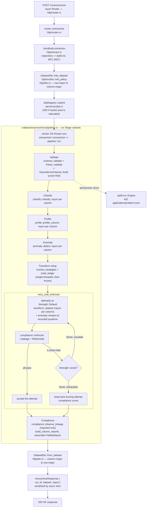

# Architecture

This document is for someone modifying the Data Layer, not calling it. For the public API,
what the service is and how to run it, see `README.md`; for the rules a change here has to
follow, see `CONTRIBUTING.md`. This document goes one layer down — the files, the pipeline
internals, and the decisions a change would otherwise undo by accident.

**This is the design of record.** A change that contradicts it is not finished until this
document is updated in the same pull request, and architecture is not changed without a reason
worth writing down. Where the two disagree, the code is what ships and this document is the bug.

The workspace is two crates. `crates/anonymizer` is the engine: synchronous, single-purpose,
no tokio, no axum, no filesystem, no clock, `#![forbid(unsafe_code)]`. `crates/server` is the
Axum HTTP transport around it, plus job/worker machinery and config. `clients/typescript` is a
generated-types HTTP client for Node. The boundary between the two crates is absolute: every
wire type, every async construct and all I/O live in `server`; `anonymizer` takes a `Dataset` and
returns an `Outcome`.

## The happy path: `POST /v1/anonymize`



Concretely, in file order:

1. **`crates/server/src/http/router.rs`** matches the path and method, runs the
   `TraceLayer`/request-id/body-limit layers, and dispatches to **`routes::anonymize`**
   (`crates/server/src/http/routes.rs`).
2. **`JsonBody<DatasetRequest>`** (`crates/server/src/http/extract.rs`) wraps axum's `Json`
   extractor so a parse failure becomes an `ApiError`, not axum's bare rejection — the RFC 9457
   contract holds from the first byte read.
3. `request.dataset.into_dataset()` and `request.options.into_policy()`
   (`crates/server/src/http/dto.rs`) do the one pivot from the wire's row-major `DatasetDto` to
   the engine's column-major `anonymizer::Dataset`, rejecting a ragged row on the way, and parse
   each `column_overrides` string into a `Strategy`. `into_dataset` ends by calling
   `anonymizer::dataset::schema::validate` itself, so a dataset that reaches the pipeline has
   already passed structural validation once.
4. `routes::anonymize` hands the dataset and policy to **`state.jobs.submit`**
   (`crates/server/src/job.rs`): `JobRegistry::submit` refuses with `JobError::Saturated` (→ HTTP
   429) if the in-flight job count is already at the worker pool's capacity, otherwise registers a
   `JobSummary` and pushes a closure onto a bounded `crossbeam-channel`. A `WorkerPool` OS thread
   (spawned once, at `AppState::new`) picks it up, flips the job's state to `Running`, installs an
   `EvictOnDrop` guard, and runs the closure to completion on that same thread — which is where
   `anonymizer::anonymize` executes, entirely synchronously, with no `spawn_blocking` and no
   nested async runtime. The result crosses back to the awaiting Axum handler over a
   `tokio::sync::oneshot`.
5. `anonymizer::anonymize` (`crates/anonymizer/src/lib.rs`) is `pipeline::run`
   (`crates/anonymizer/src/pipeline.rs`), which walks the six `Stage` variants in order:
   - **Validate** — `schema::validate(&mut dataset)` (coerces an integer literal in a float
     column, rejects ragged tables, dangling FKs, disallowed key types, etc.), `policy.validate`,
     and `EquivalenceClasses::build` (the union-find over key columns).
   - **Classify** — `classify::classify` run in parallel over every column via
     `dataset.qualified_columns()`, producing a `Classification` (semantic type + confidence) per
     column. `preserve::resolve` also runs here, expanding `Policy::preserve` into the full
     `ResolvedPreserve` set and refusing an unforced preserve on a direct identifier or UUID
     column.
   - **Profile** — `profile::profile_column` in parallel, producing a `ColumnProfile`
     (null rate, distinct count, length stats, `Distribution`) per column.
   - **Anomaly** — `anomaly::detect` in parallel, using each column's own profile, producing an
     `AnomalyScan` of row positions per `AnomalyKind`.
   - **Transform** (setup half) — `resolve_strategies` picks one `Strategy` per column
     (`transform::resolve`, or `Strategy::Keep` for anything in `ResolvedPreserve`), then
     `build_ledger` runs `LedgerBuilder::observe_dataset` single-threaded in a fixed order and
     calls `.freeze(&context)`, which mints every class's injective mapping and returns a frozen
     `Ledger`. Everything after this point only ever sees `&Ledger`.
   - **Transform/Compliance retry loop** — `retry_until_enforced` calls `attempt()` at
     `Strength::Default`: `transform_dataset` runs `Strategy::apply` per column in parallel
     against the frozen ledger, then `anomaly::reinject` re-corrupts the recorded source
     positions; `compliance::enforced` then runs the two enforced checks (`Leakage`,
     `Referential`). If either fails, `Strength::next()` escalates and the loop retries, keeping
     the best-scoring attempt (`compliance::score`) in case nothing ever passes; the ladder is
     finite (`Default → Aggressive → Maximum → None`), so termination needs no retry counter.
   - **Compliance** (report half) — `compliance::observe_linkage` runs once, against the accepted
     attempt's output, as a reported-only check. `build_column_reports` computes before/after
     distributions and anomaly rates fresh (never copied from the plan that produced them), and
     `pipeline::run` assembles the `FidelityReport`: the top-level `verdict` is the max over the
     *enforced* checks only, `accepted_strength` and `attempts` record which rung won, and
     `timings_ms` sums each stage's wall-clock time.
6. Back in `routes::anonymize`, `DatasetDto::from_dataset` pivots the anonymized column-major
   `Dataset` back to row-major, and the handler returns `AnonymizeResponse { run_id, dataset,
   report }`, which axum's `Json` serializes as the response body.
7. Any `anonymizer::Error` raised along the way — from validation, policy checks, or an
   incompatible strategy — becomes `ApiError::Engine` and is rendered by `error.rs`'s
   `IntoResponse` impl as a `422 application/problem+json` body instead of propagating as a panic.

`POST /v1/profile` is the same path through step 5's Validate/Classify/Profile/Anomaly stages
only, via `anonymizer::profile`, which never builds a ledger and never transforms.

## The four requirements, and the tests that prove each

These come from the governing spec and are the reason the service exists. Each is pinned by a
named functional test; none of the four is allowed to become a claim the suite does not check.

1. **Statistical distribution preserved per column** —
   `a_domain_preserved_categorical_column_reports_zero_total_variation_distance` and
   `email_domain_distribution_matches_exact_proportions` (`tests/compliance.rs`,
   `tests/classification_and_profiling.rs`).
2. **Correlations between tables maintained** — `fk_partition_is_isomorphic_across_a_two_hop_chain`
   (`tests/correlation.rs`): the multiset of foreign-key group sizes is preserved, and the key
   mapping is injective.
3. **Real anomalies reproduced** — `anomaly_counts_survive_the_pipeline_exactly`
   (`tests/anomalies.rs`): malformed input survives at the same per-kind count it arrived with,
   rather than being cleaned up. Production bugs must reach the sandbox.
4. **Referential integrity intact** — `an_orphan_fk_value_survives_as_an_orphan`
   (`tests/correlation.rs`) and `a_value_level_orphan_fk_survives_at_the_same_position`
   (`tests/compliance.rs`): a dangling foreign key stays dangling, at the same position, rather
   than being silently healed.

Leakage and schema preservation are not spec requirements on their own, but back all four:
`tests/leakage.rs` and `tests/compliance.rs` establish that no source value a direct identifier
held survives intact into the output or the report, and `tests/edge_cases.rs` and
`tests/parallelism.rs` establish that a pinned seed reproduces byte-identical output under both
`RAYON_NUM_THREADS=1` and `=8`.

## Repository layout

### Root

| Path | Holds |
|---|---|
| `Cargo.toml` | Workspace manifest: two members, pinned dependency versions, `resolver = "3"`, MSRV 1.85. |
| `Cargo.lock` | Locked dependency graph; CI builds with `--locked`. |
| `README.md` | User-facing: what the service is, its endpoints, and how to build, run and test it. |
| `ARCHITECTURE.md` | This document. The design of record: pipeline internals, file-by-file layout, and the decisions a change must not undo by accident. |
| `CONTRIBUTING.md` | The rules: branch and pull-request workflow, commit format, code conventions, and how engine fine-tuning is done. |
| `HANDOFF.md` | Live state carried between work sessions: open questions, the recurring bug class, decisions taken in conversation. |
| `AGENTS.md` | Entry point for coding agents; points at the three documents above. |
| `Dockerfile` | Multi-stage build: `rust:1-slim-bookworm` compiles `-p server --release`, `debian:bookworm-slim` runs it as a non-root user. |
| `.github/workflows/ci.yml` | Three jobs: `check` (fmt, clippy, test under both thread counts, release build), `typescript` (regenerate bindings, diff, count, typecheck, test), `publish-image` (GHCR build-and-push, gated on the first two). |
| `fixtures/` | Five JSON datasets shared across Rust and (where named directly) TypeScript tests: `anomalies.json`, `dangling_fk.json`, `misleading_columns.json`, `multi_table_fk_chain.json`, `unicode_and_nulls.json`. |

### `crates/anonymizer/src/` (17 files)

| File | Holds |
|---|---|
| `lib.rs` | Crate root: `#![forbid(unsafe_code)]`, module declarations, the public `anonymize`/`profile` functions and the `Outcome` struct. Everything else is reachable but not the contract. |
| `error.rs` | `Error`, one `thiserror` enum covering every rejection the engine can produce — validation, policy conflicts, ledger exhaustion, missing report data. |
| `policy.rs` | `Policy` (seed, column overrides, preserve set, `force_preserve`) and its `validate` against a concrete dataset. |
| `context.rs` | `RunContext`: the request-scoped seed, policy, `Option<Ledger>` and stage timings, plus `rng_for`/`rng_for_row_position`, the only way the rest of the crate draws randomness. |
| `rng.rs` | Deterministic RNG derivation: `blake3::keyed_hash` over the run seed and a label, seeding `ChaCha8Rng`. |
| `dataset/mod.rs` | `Dataset`, `Table`, `ColumnData` — the column-major in-memory shape every stage operates on. |
| `dataset/schema.rs` | `ColumnType`, `ColumnSpec`, `ForeignKey`, `TableSchema`, and `validate`/`check` (the mutating and read-only halves of structural validation). |
| `dataset/value.rs` | `Value` (the wire cell — `Null`/`Bool`/`Int`/`Float`/`Text`) and `KeyValue` (the hashable, orderable subset admissible as a key). |
| `classify.rs` | `SemanticType` and `classify()` — column-name hints plus sampled value-shape evidence; CPF/CNPJ check-digit validators. |
| `profile.rs` | `ColumnProfile`, `Distribution` (`Categorical`/`Numeric`/`Unsummarised`), total variation distance, and the median/MAD numeric summary. |
| `anomaly.rs` | `AnomalyKind`, `detect()` (per-kind scanning), `corrupt()`/`reinject()` (synthesis and position-preserving re-injection). |
| `preserve.rs` | `PreserveReason` and `resolve()`: expands a policy's preserve request set into every column `Strategy::Keep` must run under, including equivalence-class propagation. |
| `transform/mod.rs` | `Strategy` (the enum of value-local transforms) and `apply`/`resolve`; every transform's implementation (`pseudonymize_email`, `preserve_prefix`, `regenerate_document`, `resample_name`, `jitter_*`, `redact`, `sanitize`). |
| `transform/ledger.rs` | `EquivalenceClasses` (union-find `Forest`), `LedgerBuilder`/`Ledger`, and the `mint`/`mint_uuid` injective-minting functions. |
| `compliance.rs` | `Check`, `Verdict`, `CheckOutcome`; `enforced()` (leakage + referential), `observe_linkage()` (reported), `score()` (for picking the best failing attempt). |
| `pipeline.rs` | `Stage` and `run()` — the orchestration described above: six stages, the retry loop, report assembly. |
| `report.rs` | `FidelityReport`, `ColumnReport`, `AnomalyRates` — the compliance artifact returned to the caller. |

### `crates/anonymizer/tests/` (13 files)

Each file is a functional test through the public API (`anonymize`/`profile`), driven against
hand-built or fixture datasets — no unit test lives outside `#[cfg(test)]` modules beside the code
they check. What each file pins:

| File | Pins |
|---|---|
| `validation.rs` | Schema rejection paths: duplicate names, ragged tables, dangling/invalid foreign keys, disallowed key types, type mismatches, null handling, int-to-float coercion, schema round-tripping. |
| `classification_and_profiling.rs` | Classification follows values over a misleading column name; email domain distribution matches exact source proportions. |
| `anomalies.rs` | Anomaly counts survive the pipeline exactly (spec requirement #3); anomaly reporting never leaks the flagged values; profile surfaces per-kind anomaly rates. |
| `correlation.rs` | The FK partition is isomorphic across a two-hop chain — group-size multiset preserved and the key mapping injective (spec requirement #2); an orphan FK value survives as an orphan. |
| `key_identity.rs` | UUID-shaped values mint to the same output across unrelated tables (global identity); distinct UUIDs never collide; integers do not merge across unrelated equivalence classes; a `MintKey`/`MintUuid` mismatch within one UUID-linked class is rejected. |
| `preserve.rs` | Preserving a single column vs. a whole table; class propagation across a preserved key; the direct-identifier/UUID preserve refusal and the `force_preserve` override; preserve/override conflicts. |
| `leakage.rs` | No raw direct-identifier source value survives into the output or the report, holding across many seeds (a stronger, test-only substring-containment check than the enforced runtime one). |
| `compliance.rs` | The enforced/reported check split end to end: a clean dataset passes everything; dirty direct identifiers still clear leakage; a value-level orphan FK survives at the same position (spec requirement #4); a preserved direct identifier is named but not flagged; a unique quasi-identifier combination warns without mutating values; no source value reaches the serialized report; a pinned seed is byte-identical across an escalating run; a domain-preserved categorical column reports zero TVD; a `ResampleName` collision heals under escalation. Also carries the `#[ignore]`d `a_value_that_survives_in_large_part_is_flagged_as_leaked` — see "What this build does not do." |
| `edge_cases.rs` | Empty tables, all-null columns, single-row tables, unicode values, non-ASCII text keys, self-referencing FKs, composite primary keys, FK cycles, dangling FKs. |
| `row_order.rs` | Row order is preserved across a table with both a self-reference and an FK cycle — the contract the "mint everything" cost argument depends on. |
| `parallelism.rs` | A pinned seed reproduces byte-identical output under `RAYON_NUM_THREADS=1` and `=8`. |
| `pipeline.rs` | A pinned seed reproduces byte-identical output (single-threaded baseline); schema is preserved across the pipeline; an unsummarised column reports zero TVD; a passthrough run reports one column entry per column. |
| `core_types.rs` | `KeyValue`/`Value` admissibility and JSON round-tripping — the smallest leaf-level functional checks that still go through serde rather than construction alone. |

### `crates/server/src/` (11 files)

| File | Holds |
|---|---|
| `main.rs` | Process entry point: reads `Config`, initializes telemetry, builds the router, binds, serves with graceful shutdown on `ctrl_c`. |
| `lib.rs` | Crate root: `#![forbid(unsafe_code)]`, module declarations. |
| `config.rs` | `Config::from_env()` — every `DL_`-prefixed environment variable (bind address, body limit, rayon threads, worker pool size, log level) and its default. |
| `telemetry.rs` | Installs the process-wide `tracing` subscriber, idempotently. |
| `job.rs` | `JobRegistry`, `WorkerPool`, `JobId`/`JobKind`/`JobState`/`JobSummary` — the owned-OS-thread worker pool and in-flight job bookkeeping described above. |
| `http/mod.rs` | `AppState` (config + job registry handles) and module wiring. |
| `http/router.rs` | The `axum::Router`: route table, body-limit/request-id/trace layers. |
| `http/routes.rs` | The five handlers: `health`, `detectors`, `jobs`, `profile`, `anonymize`. |
| `http/extract.rs` | `JsonBody<T>`, the `Json` wrapper that turns extraction rejections into `ApiError`. |
| `http/error.rs` | `ApiError`, `Problem` (RFC 9457 body), and the `IntoResponse` impl that renders every error path as `application/problem+json`. |
| `http/dto.rs` | `DatasetDto`/`TableDto`/`ColumnDto`/`WireType`/`OptionsDto`, the request/response wire types, and the row-major ⇄ column-major pivot (`into_dataset`/`from_dataset`). |

### `crates/server/tests/` (7 files)

| File | Pins |
|---|---|
| `health.rs` | `GET /health` returns `{status: "ok", version}`. |
| `detectors.rs` | `GET /v1/detectors` lists every `SemanticType` this build recognizes. |
| `jobs.rs` | A panicking job neither poisons the worker pool nor leaks its registry entry; submitting past capacity is rejected; a cancelled caller does not free a slot the job still occupies. |
| `errors.rs` | Every error path — an unmatched route, a wrong method on a real route, a method mismatch — renders as RFC 9457; a `HEAD` request on a `GET` route still works. |
| `dto.rs` | The row-major/column-major pivot is lossless; a dangling FK is rejected with a useful message at the DTO boundary; an unknown strategy name is rejected; a known one resolves. |
| `profile.rs` | `POST /v1/profile` classifies and profiles without transforming; the response never carries the run seed; classification follows values over a lying column name; anomaly rates surface for every kind; a malformed payload is rejected. |
| `anonymize.rs` | The full HTTP happy path on a multi-table FK-chain fixture; before/after anomaly rates match on the wire; malformed payload, dangling FK, oversized body, unknown column override, unknown strategy name, and unknown preserve target are all rejected with a useful message; preserve wired through the HTTP boundary keeps the column and reports it; worker pool saturation returns 429. |

### `clients/typescript/`

| Path | Holds |
|---|---|
| `src/index.ts` | The one exported class, `DataLayer`: `connect()` (a static async factory that probes `/health` before resolving), `anonymize()`/`profile()` (returning a `{success, ...}` result union rather than throwing on a problem response), `detectors()`/`jobs()` (introspection calls that throw on failure), and the custom `JSON.parse` reviver that preserves large integers as digit strings (see README's "What this PoC engine does not do" note on `i64` vs. JS `number`). |
| `src/generated/*.ts` (35 files) | **Generated, never hand-written.** Every request/response type `#[cfg_attr(feature = "ts", derive(ts_rs::TS))]` marks in the Rust source is emitted here by [`ts-rs`](https://github.com/Aleph-Alpha/ts-rs) when the crates build with `--features ts` and run their `export_bindings` tests. CI deletes this directory, regenerates it, and fails the build on any diff against what is checked in, plus a hard count check (`expected=35`) so a refactor that silently drops every `#[ts(export)]` derive cannot pass with an empty, technically-matching diff. |
| `test/data-layer.test.ts`, `test/fixtures/*.json` | `node:test` suite against a mocked `global.fetch`: connection probing success/failure paths, a recorded success and a recorded problem+json response, the three-keys-past-2^53 integer-preservation case, `detectors()`/`jobs()`, and transport-failure wrapping. |
| `package.json`, `tsconfig.json`, `package-lock.json` | Node package manifest (CommonJS, ES2022 target, `strict: true`) and its locked dependency tree (`@types/node`, `typescript` as the only dependencies — the client itself has none at runtime beyond `fetch`). |
| `dist/`, `node_modules/` | Build and dependency output, gitignored — not source. |

## Load-bearing design decisions

Each of these is a place a well-intentioned refactor would plausibly "fix" something that is
deliberate. Changing one is a legitimate thing to want; doing it without replacing the reasoning
below is not.

**Statelessness, and `RunContext` owned by the request.** `RunContext` (`context.rs`) holds the
run seed, the policy, the ledger (`None` until frozen), and stage timings — built fresh inside
`pipeline::run` and dropped when the response is sent. `AppState` never holds one; `JobRegistry`
holds only `JobSummary` metadata, never a dataset or a report. This mirrors OpenResty's `ngx.ctx`
semantics deliberately: statelessness is the privacy posture here, not an efficiency choice —
nothing from one request can leak into another because nothing survives past the response that
produced it.

**Referential equivalence classes via union-find, and why they dissolve FK cycles.**
`EquivalenceClasses::build` (`transform/ledger.rs`) runs a disjoint-set `Forest` over every key
column, unioning the two endpoints of each FK edge. A chain `c.x → b.y → a.z` collapses into one
class by transitivity, which is what lets a single ledger mapping back every member and makes
requirement #4 (referential integrity) hold across more than one hop. Union-find does not care
about edge direction, so an FK cycle is not a special case needing detection or a topological
sort — it just unions like any other edge and the forest ends up with one class instead of
failing to order.

**Minting versus hashing, and why truncated hashes are not injective.** Pseudonymizing a key by
hashing into a fixed width is not injective at any realistic scale — a few hundred thousand
integer keys hashed into an `i32` collide with near-certainty, and a collision silently merges
two unrelated parent rows, which is exactly requirement #4's failure mode. `mint()`
(`transform/ledger.rs`) instead draws a candidate of the source's own `KeyValue` variant and
width from a seeded stream and retries on collision against the set already used in that class,
up to a cap sized to the candidate space, so an exhausted domain fails loudly
(`Error::KeyDomainExhausted`) rather than silently colliding.

**The determinism contract.** A pinned `options.seed` must reproduce byte-identical output under
any `RAYON_NUM_THREADS`, enforced as a test (`tests/parallelism.rs`), not an aspiration:

- `ChaCha8Rng` only (`rng.rs`), never `StdRng`, which is explicitly not guaranteed reproducible
  across Rust releases.
- `BTreeMap` everywhere a map reaches output or report — `FidelityReport`, `CheckOutcome`,
  `Ledger`'s mappings — so no `HashMap` iteration order can escape into a result.
- The ledger is built single-threaded in a fixed order (classes sorted by name, values in row
  order) and then frozen; the column-parallel transform stage only ever sees `&Ledger`, never a
  mutable one, which is what lets `RunContext` typecheck as `&mut` during the build phase and `&`
  during transform.
- `Strength` is folded into the per-row RNG label (`context.rng_for_row_position`), not just into
  how a strategy uses its draw: without this, an escalation retry would replay the same stream
  into a smaller output space and could make a collision it was meant to fix *more* likely, rather
  than genuinely redrawing.

**Value-local transforms, making distribution fidelity an invariant.** No transform resamples a
column from a fitted distribution. Each one operates on a single value and preserves exactly the
part that carries the distribution — the email domain, the phone/CEP prefix, the document's
check-digit validity, the name's token count, a numeric or date value's own neighborhood. Because
nothing about one row's transform depends on the rest of the column, the domain histogram survives
by construction: the TVD the report surfaces is expected to be exactly `0.0`, a claim the engine
proves rather than estimates. Independent per-column resampling is the obvious alternative and is
rejected: fitting each column separately and drawing fresh values reproduces every marginal
distribution while silently decorrelating columns that must stay joint, like `city`/`state`.

**Median/MAD over mean/stddev for anomaly detection.** `profile.rs` computes both, but
`anomaly::is_out_of_range` is keyed on `median`/`mad` (scaled by `MAD_TO_SIGMA`), not `mean`/
`stddev`. Mean and standard deviation have a breakdown point of `1/n`: a handful of injected
outliers pulls the mean toward itself and inflates the standard deviation computed from it until
the outliers no longer look far from it — the very statistic meant to catch them becomes
unreliable at the injection rate the engine itself produces. Median and MAD keep a 50% breakdown
point, so detection stays accurate at any realistic rate.

**Row order as a tested contract, and why that is what makes "mint everything" affordable.**
`tests/row_order.rs` pins that a table's rows come back in exactly the order they arrived,
including under self-reference and FK cycles; `lib.rs`'s module doc states the same as a crate-wide
invariant nothing — not minting, not profiling, not anomaly re-injection — may violate. This is
what lets every key mint by default, integers included: the caller (Backend Core) still holds the
dump it sent, so it recovers any mapping it needs by positional join rather than by matching
values, which would be impossible once they are minted.

**Enforced versus reported compliance checks, and why linkage is never enforced.**
`compliance::enforced` runs only `Leakage` and `Referential` — the two checks that drive a retry
and feed the top-level `verdict`. `Linkage` (`observe_linkage`) is computed and reported
(`k_observed`, warning below a threshold of 5) but never gates anything, because distribution
fidelity and k-anonymity pull against each other: forcing a rare value's equivalence class above
some minimum size means mutating exactly the value the engine exists to preserve faithfully. v0
declares this precedence rather than pretending both can be optimized at once.

**`rayon` for column-parallel work inside owned OS threads, `tokio` as HTTP transport only.**
`crates/anonymizer` has no tokio dependency at all; every pipeline stage parallelizes over
`dataset.qualified_columns()` with `rayon`'s `par_iter`. `crates/server/src/job.rs`'s `WorkerPool`
spawns a fixed number of real OS threads (`thread::Builder::spawn`), each pulling from a bounded
`crossbeam-channel`; a submitted job runs to completion on the thread that picked it up, so rayon
work started inside it runs on that same thread — no `spawn_blocking`, no nested runtime. The
Axum handler awaits a `tokio::sync::oneshot` to get the result back onto the async reactor. This
keeps tokio's single-threaded-per-task reactor free of CPU-bound work while giving rayon genuine
parallelism to fan out over, and it is why the worker pool, not tokio, is what a saturated-load
`429` reflects.

## What this build deliberately does not do

The engine is a crude proof of concept on purpose: the HTTP surface, job machinery, determinism
guarantees and report shape are built to outlive a smarter engine plugged in underneath them, but
the engine itself is not that smarter version yet. `grep "TODO: fine tune" crates/` surfaces the
four engine-specific entries inline at the exact line they apply to:

| Location | Gap |
|---|---|
| `compliance.rs:164` (and the `#[ignore]`d test in `tests/compliance.rs`) | **The leakage check compares whole values only.** A cell is flagged only when it equals a source cell outright — substring or large-fraction survival is invisible to it. At seed 1, `"NASCIDO EM 1972"` anonymizing to `"NASCIDOx EM 1309"` changes three characters, keeps the other thirteen (including a stray detected test artifact), and the enforced check reports `pass`. This produced a real PII leak across three earlier phases (`HANDOFF.md`'s "recurring bug class"). A fixed-pattern residue detector is not a safe blind fix: it would have to distinguish `PreservePrefix`'s *intentional* verbatim area code from an *unintentional* one, and getting that distinction wrong either breaks `PreservePrefix` by design or still misses the residue by accident. The gap is pinned, not patched over: `a_value_that_survives_in_large_part_is_flagged_as_leaked` is `#[ignore]`d in `crates/anonymizer/tests/compliance.rs` and asserts the behavior wanted; making it pass without breaking `PreservePrefix` is the calibration work. |
| `anomaly.rs:50` | `MalformedName` lumps all-caps, all-lowercase and embedded-digit malformations into one `AnomalyKind`, so the pipeline preserves the total count but not the mix between the three sub-shapes. |
| `transform/mod.rs:551` | `ResampleName`'s pool shrinks as `Strength` escalates (400 → 64 → 9 combinations), so an escalation retry samples from an increasingly cramped space; a large enough dataset collides *more* at `Maximum` than at `Default` even with independent redraws per attempt. |
| `transform/ledger.rs:22` | A composite primary key's member columns are unioned only through their own individual FK edges, never correlated with each other directly — out of scope for this PoC. |

Beyond those five, by design rather than oversight:

- **No distinction between a surrogate key and an ordinary numeric measurement.** `classify`
  short-circuits to a numeric type whenever every sampled value is numeric, so a plain age or
  price stored as an integer mints exactly like a CPF stored as `BIGINT` — nothing numeric is
  trusted with pass-through, because the classifier cannot tell the two apart.
- **No non-production-row detection** (admin/test/seed fixtures mixed into real data) — see
  below for the design it should follow when someone builds it.
- **No differential privacy, ML-assisted PII detection, or Oracle Data Safe cross-check.** Out of
  scope for this PoC per the governing spec's Part 4.1/4.2.
- **No streaming and no async job endpoint.** The whole dataset is held in memory; the
  `JobRegistry`/`WorkerPool` machinery exists and is exercised (`GET /v1/jobs`), but every HTTP
  request is still synchronous from the caller's point of view — there is no "submit, poll,
  fetch" flow yet.
- **No cross-run pseudonym stability.** Two separate requests over the same source data mint
  unrelated outputs; there is no durable sandbox identity across runs.
- **No fairness between concurrent requests.** A single large request can monopolize the rayon
  pool; nothing yet partitions or throttles rayon work per caller.

### Designs worth keeping for when they get built

Two gaps above have had their shape worked out already. The reasoning is recorded because in both
cases the obvious implementation is the wrong one.

**Non-production rows.** Rows that are structurally valid but are not real production data:
`admin@`, `test@test`, `@mailinator.com`, "Test User", `(00) 00000-0000`, textbook-valid CPFs,
the seeded `id=1` account. They matter for three reasons — they poison the fitted distribution,
they inflate the data-quality anomaly rates with deliberate breakage, and their presence is
itself worth reporting to whoever owns the dump.

Model it as **per-row provenance, not an `AnomalyKind`**. Every anomaly kind owes a `corrupt` arm
and a detect↔corrupt round-trip, and there is no way to corrupt a clean value into being an admin
account. Forcing it into that enum breaks the round-trip test, and the tempting repair is to
weaken the test rather than fix the modelling.

Ship it **report-only** first. Passing suspected test rows through verbatim is attractive — QA
keeps its known fixtures in the sandbox — but the error is asymmetric: a false negative costs
nothing, while a false positive releases a real customer unanonymized. Pass-through needs a
reviewed allowlist, never a heuristic alone.

Score **per field, not per row**, and treat disagreement within a row as the signal worth
escalating. A row that is unanimously test-shaped is safe to be confident about; a row with a
textbook-fake CPF beside a real-looking email and address is most likely a real person whose
document was never captured, so someone typed a placeholder in. That row is real PII wearing a
test-data costume, and it is exactly what pass-through would leak. Surface it:

```
7 entries look dev/ops related — "test"/"admin" tokens and known-fake CPFs.
1 of those pairs a known-fake CPF with a real-looking email and address.
Flag it for review?
```

## Considered and rejected

Alternatives that come up naturally and have already been decided against. Reopening one is
fine; reopening it without new information is not.

- **Independent per-column resampling instead of value-local transforms.** See
  "Value-local transforms" above: it preserves every marginal and destroys the joint.
- **Hashing keys instead of minting them.** See "Minting versus hashing": truncated hashes are
  not injective, and the collision is silent.
- **A Unix domain socket instead of TCP.** It would remove the network surface for PII and the
  risk of binding `0.0.0.0` by mistake, but every other service in the platform is a container
  with a port, and sharing a socket across containers needs a shared volume. Not worth being the
  odd one out in a compose file four other people run.
- **Spawning the service as a child process of Backend Core.** Good local-dev ergonomics, but it
  needs a supervisor (restart, backoff, readiness, zombie reaping, log demuxing), couples the two
  services' deployment, and makes the Data Layer no longer independently addressable. Process
  supervision is a solved problem that belongs to the container runtime, not to Node.
- **FFI into Backend Core.** The serialization cost it would save is real, but the process
  boundary is part of the platform's compliance argument, and a Rust abort would take the
  migration orchestrator down with it. Revisit only if the engine is ever embedded inline — an
  anonymizing read proxy in front of the sandbox would be the case that justifies it.

## Where this sits in the platform

The Data Layer is one of five services. It never reads or writes production, holds no database
connection of its own, and owns no authentication: Backend Core owns RBAC and calls this service
over HTTP with the rows already in hand. Deciding *what* to migrate, resolving schema and type
conflicts, and writing to a target database all belong to the orchestrator and the AI Layer.

Cross-service composition is expected to land in a thin `placeholder-platform` repository once
the services stabilise, holding only `docker-compose.yml`, cross-service integration tests and
platform-level docs, and referencing each service as a published GHCR image rather than as
source. Not git submodules — their detached HEADs and forgotten pointer updates cost a
five-person team more than they save. That repository's real job is recording which five service
versions are known to work together, with a gitignored `docker-compose.override.yml` building
one service from a sibling checkout so local iteration does not require an image push.

The cost of that topology is that a cross-service contract change becomes two-phase: publish an
image here, then bump the tag there. Which is the strongest argument for the generated TypeScript
client — with types derived from the Rust DTOs, a contract change breaks Backend Core at compile
time instead of at runtime during integration.

## Working on it

```sh
cargo build --workspace --locked
cargo clippy --workspace --all-targets --all-features -- -D warnings
cargo fmt --all --check
RAYON_NUM_THREADS=1 cargo test --workspace
RAYON_NUM_THREADS=8 cargo test --workspace
```

Both thread counts matter, and neither substitutes for the other: a test process can only set
rayon's global pool size once, at construction, so the determinism contract — a pinned seed
reproducing byte-identical output regardless of how rayon splits the work — is only established
by actually running the full suite under each count. At the time of writing that is **233 tests
passing and 1 intentionally ignored** (`crates/anonymizer/tests/compliance.rs`'s
`a_value_that_survives_in_large_part_is_flagged_as_leaked`, see above) under both counts.
Adding `--all-features` brings the total to 268, the extra 35 being the `ts-rs` binding-export
tests, which emit TypeScript rather than assert behaviour.

### Regenerating the TypeScript bindings

```sh
rm -rf clients/typescript/src/generated
cargo test --workspace --features ts export_bindings
```

Run this after adding, removing, or changing the shape of any type carrying
`#[cfg_attr(feature = "ts", derive(ts_rs::TS))]`. CI does exactly this from a clean checkout, then
`git diff --exit-code` against what is committed, and separately asserts the generated file count
is exactly 35 — the second check exists because a refactor that quietly drops every `#[ts(export)]`
derive would otherwise regenerate zero files and still pass an empty diff.

### Running the server

```sh
cargo run -p server
```

Reads `DL_`-prefixed environment variables (`DL_BIND_ADDR`, `DL_BODY_LIMIT_BYTES`,
`DL_RAYON_THREADS`, `DL_WORKER_THREADS`, `DL_LOG_LEVEL`; see `crates/server/src/config.rs` for
defaults). Or via Docker:

```sh
docker build -t placeholder-data-layer .
docker run -p 8080:8080 placeholder-data-layer
```

### What CI enforces (`.github/workflows/ci.yml`)

| Job | Steps |
|---|---|
| `check` | `cargo fmt --all --check`, `cargo clippy --workspace --all-targets --all-features -- -D warnings`, the test suite under both `RAYON_NUM_THREADS=1` and `=8`, then `cargo build --workspace --release`. |
| `typescript` | Regenerate bindings from a clean `src/generated/`, diff against what is committed, assert the file count is 35, then `npm ci`, `npm run typecheck`, `npm test` in `clients/typescript`. |
| `publish-image` | Builds the `Dockerfile` on every push and pull request (so a broken image build fails before merge); pushes to `ghcr.io/<owner>/<repo>:latest` and `:<sha>` only on a push to `main`, and only once `check` and `typescript` both pass. |
